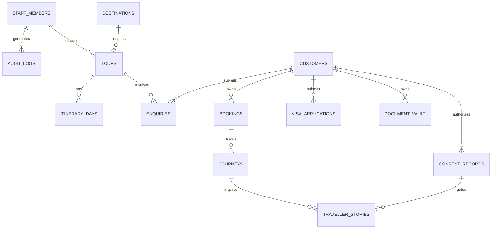

# Bilal Travels & Tours — Relational Database Schema & Data Governance

**Document Version:** 1.0.0  
**Database Engine:** PostgreSQL 16+  
**Phase:** Phase 3 — Database Architecture & Data Isolation  
**Project Owner:** Bilal Travels & Tours  
**Engineering Agent:** Antigravity Autonomous Engineering Agent  
**Status:** DDL Ready & Validated  

---

## 1. Relational Entity-Relationship Diagram (ERD)



---

## 2. PostgreSQL DDL Specification

```sql
-- ============================================================================
-- 1. EXTENSIONS & ENUMS
-- ============================================================================
CREATE EXTENSION IF NOT EXISTS "uuid-ossp";
CREATE EXTENSION IF NOT EXISTS "pgcrypto";

-- Staff Roles Enum
CREATE TYPE staff_role_enum AS ENUM (
    'SUPER_ADMIN',
    'OPERATIONS_MANAGER',
    'CONTENT_EDITOR',
    'AUDITOR'
);

-- Tour Types Enum
CREATE TYPE tour_type_enum AS ENUM (
    'GROUP',
    'PRIVATE',
    'HONEYMOON',
    'FAMILY',
    'ADVENTURE',
    'UMRAH_SPECIAL'
);

-- Lead / Enquiry Status Enum
CREATE TYPE enquiry_status_enum AS ENUM (
    'NEW',
    'IN_REVIEW',
    'CONTACTED',
    'QUOTED',
    'CONVERTED',
    'LOST',
    'SPAM'
);

-- Visa Application Milestone Enum
CREATE TYPE visa_milestone_enum AS ENUM (
    'SUBMITTED',
    'DOCS_VERIFIED',
    'EMBASSY_PROCESSING',
    'ADDITIONAL_DOCS_REQUIRED',
    'VISA_APPROVED',
    'VISA_REJECTED',
    'VOUCHERS_ISSUED',
    'TRAVEL_ACTIVE',
    'COMPLETED'
);

-- Consent Status Enum
CREATE TYPE consent_status_enum AS ENUM (
    'REQUESTED',
    'VERIFIED',
    'REVOKED',
    'EXPIRED'
);

-- Content Publishing Status Enum
CREATE TYPE publishing_status_enum AS ENUM (
    'DRAFT',
    'UNDER_REVIEW',
    'PUBLISHED',
    'ARCHIVED',
    'WITHDRAWN'
);

-- ============================================================================
-- 2. STAFF & ACCESS CONTROL
-- ============================================================================
CREATE TABLE staff_members (
    id UUID PRIMARY KEY DEFAULT uuid_generate_v4(),
    email VARCHAR(255) UNIQUE NOT NULL,
    full_name VARCHAR(150) NOT NULL,
    role staff_role_enum NOT NULL DEFAULT 'CONTENT_EDITOR',
    is_active BOOLEAN NOT NULL DEFAULT true,
    created_at TIMESTAMPTZ NOT NULL DEFAULT NOW(),
    updated_at TIMESTAMPTZ NOT NULL DEFAULT NOW()
);

-- ============================================================================
-- 3. DESTINATIONS & TOURS CATALOG
-- ============================================================================
CREATE TABLE destinations (
    id UUID PRIMARY KEY DEFAULT uuid_generate_v4(),
    name VARCHAR(100) NOT NULL,
    slug VARCHAR(120) UNIQUE NOT NULL,
    country_name VARCHAR(100) NOT NULL,
    country_code VARCHAR(3) NOT NULL,
    tagline VARCHAR(200),
    description TEXT,
    hero_image_url TEXT NOT NULL,
    thumbnail_image_url TEXT NOT NULL,
    tags TEXT[] DEFAULT ARRAY[]::TEXT[],
    is_featured BOOLEAN NOT NULL DEFAULT false,
    display_order INT DEFAULT 0,
    created_at TIMESTAMPTZ NOT NULL DEFAULT NOW(),
    updated_at TIMESTAMPTZ NOT NULL DEFAULT NOW()
);

CREATE TABLE tours (
    id UUID PRIMARY KEY DEFAULT uuid_generate_v4(),
    destination_id UUID REFERENCES destinations(id) ON DELETE SET NULL,
    title VARCHAR(200) NOT NULL,
    slug VARCHAR(220) UNIQUE NOT NULL,
    subtitle VARCHAR(255),
    tour_type tour_type_enum NOT NULL DEFAULT 'GROUP',
    duration_days INT NOT NULL CHECK (duration_days > 0),
    duration_nights INT NOT NULL CHECK (duration_nights >= 0),
    base_price_pkr INT NOT NULL CHECK (base_price_pkr >= 0),
    price_prefix VARCHAR(50) DEFAULT 'From:',
    featured_image_url TEXT NOT NULL,
    gallery_image_urls TEXT[] DEFAULT ARRAY[]::TEXT[],
    inclusions TEXT[] NOT NULL DEFAULT ARRAY[]::TEXT[],
    exclusions TEXT[] NOT NULL DEFAULT ARRAY[]::TEXT[],
    is_featured BOOLEAN NOT NULL DEFAULT false,
    status publishing_status_enum NOT NULL DEFAULT 'DRAFT',
    created_by UUID REFERENCES staff_members(id),
    created_at TIMESTAMPTZ NOT NULL DEFAULT NOW(),
    updated_at TIMESTAMPTZ NOT NULL DEFAULT NOW()
);

CREATE TABLE itinerary_days (
    id UUID PRIMARY KEY DEFAULT uuid_generate_v4(),
    tour_id UUID NOT NULL REFERENCES tours(id) ON DELETE CASCADE,
    day_number INT NOT NULL,
    title VARCHAR(200) NOT NULL,
    description TEXT NOT NULL,
    meals VARCHAR(100) DEFAULT 'Breakfast',
    hotel_stay VARCHAR(150),
    created_at TIMESTAMPTZ NOT NULL DEFAULT NOW(),
    UNIQUE (tour_id, day_number)
);

-- ============================================================================
-- 4. CUSTOMERS, ENQUIRIES & LEADS
-- ============================================================================
CREATE TABLE customers (
    id UUID PRIMARY KEY DEFAULT uuid_generate_v4(),
    auth_user_id UUID UNIQUE, -- Linked to Supabase Auth / PostgreSQL Auth
    full_name VARCHAR(150) NOT NULL,
    email VARCHAR(255) UNIQUE NOT NULL,
    phone_number VARCHAR(50) NOT NULL,
    passport_number VARCHAR(50), -- Strictly Private
    cnic_number VARCHAR(25),     -- Strictly Private
    created_at TIMESTAMPTZ NOT NULL DEFAULT NOW(),
    updated_at TIMESTAMPTZ NOT NULL DEFAULT NOW()
);

CREATE TABLE enquiries (
    id UUID PRIMARY KEY DEFAULT uuid_generate_v4(),
    reference_no VARCHAR(50) UNIQUE NOT NULL,
    customer_name VARCHAR(150) NOT NULL,
    customer_email VARCHAR(255) NOT NULL,
    customer_phone VARCHAR(50) NOT NULL,
    service_type VARCHAR(50) NOT NULL, -- 'TOUR_PACKAGE', 'VISA_CONSULTANCY', 'UMRAH', 'CUSTOM'
    tour_id UUID REFERENCES tours(id) ON DELETE SET NULL,
    target_destination VARCHAR(100),
    departure_date DATE,
    adults_count INT NOT NULL DEFAULT 1 CHECK (adults_count >= 1),
    children_count INT NOT NULL DEFAULT 0 CHECK (children_count >= 0),
    estimated_budget_pkr VARCHAR(50),
    message TEXT,
    status enquiry_status_enum NOT NULL DEFAULT 'NEW',
    assigned_staff_id UUID REFERENCES staff_members(id) ON DELETE SET NULL,
    internal_notes TEXT, -- Strictly Private to agency staff
    ip_hash VARCHAR(64),
    created_at TIMESTAMPTZ NOT NULL DEFAULT NOW(),
    updated_at TIMESTAMPTZ NOT NULL DEFAULT NOW()
);

-- ============================================================================
-- 5. VISA APPLICATIONS & CUSTOMER JOURNEYS
-- ============================================================================
CREATE TABLE visa_applications (
    id UUID PRIMARY KEY DEFAULT uuid_generate_v4(),
    application_no VARCHAR(50) UNIQUE NOT NULL,
    customer_id UUID NOT NULL REFERENCES customers(id) ON DELETE CASCADE,
    country_code VARCHAR(3) NOT NULL,
    visa_category VARCHAR(100) NOT NULL,
    current_milestone visa_milestone_enum NOT NULL DEFAULT 'SUBMITTED',
    submission_date DATE NOT NULL DEFAULT CURRENT_DATE,
    expected_decision_date DATE,
    decision_date DATE,
    created_at TIMESTAMPTZ NOT NULL DEFAULT NOW(),
    updated_at TIMESTAMPTZ NOT NULL DEFAULT NOW()
);

CREATE TABLE document_vault (
    id UUID PRIMARY KEY DEFAULT uuid_generate_v4(),
    customer_id UUID NOT NULL REFERENCES customers(id) ON DELETE CASCADE,
    visa_application_id UUID REFERENCES visa_applications(id) ON DELETE SET NULL,
    document_type VARCHAR(100) NOT NULL, -- 'E_VISA', 'AIR_TICKET', 'HOTEL_VOUCHER', 'PASSPORT_SCAN'
    file_title VARCHAR(200) NOT NULL,
    private_storage_path TEXT NOT NULL, -- Path in private S3 bucket, NEVER public URL
    file_size_bytes INT,
    mime_type VARCHAR(100),
    uploaded_at TIMESTAMPTZ NOT NULL DEFAULT NOW()
);

-- ============================================================================
-- 6. CONSENT-CONTROLLED TRAVELLER STORIES
-- ============================================================================
CREATE TABLE consent_records (
    id UUID PRIMARY KEY DEFAULT uuid_generate_v4(),
    customer_id UUID NOT NULL REFERENCES customers(id) ON DELETE CASCADE,
    scope VARCHAR(100) NOT NULL DEFAULT 'WEBSITE_ONLY',
    allowed_display_name VARCHAR(100) NOT NULL, -- e.g. "Faiz M." or "Anonymous"
    evidence_document_path TEXT, -- Digital consent signature or uploaded signed form
    status consent_status_enum NOT NULL DEFAULT 'REQUESTED',
    granted_at TIMESTAMPTZ,
    revoked_at TIMESTAMPTZ,
    created_at TIMESTAMPTZ NOT NULL DEFAULT NOW()
);

CREATE TABLE traveller_stories (
    id UUID PRIMARY KEY DEFAULT uuid_generate_v4(),
    consent_record_id UUID NOT NULL REFERENCES consent_records(id) ON DELETE RESTRICT,
    destination_id UUID REFERENCES destinations(id) ON DELETE SET NULL,
    title VARCHAR(200) NOT NULL,
    slug VARCHAR(220) UNIQUE NOT NULL,
    traveller_name VARCHAR(100) NOT NULL, -- MUST match consent_records.allowed_display_name
    travel_month_year VARCHAR(50) NOT NULL,
    story_body TEXT NOT NULL,
    approved_photo_urls TEXT[] NOT NULL DEFAULT ARRAY[]::TEXT[],
    is_approved_by_admin BOOLEAN NOT NULL DEFAULT false,
    approved_by_staff_id UUID REFERENCES staff_members(id),
    status publishing_status_enum NOT NULL DEFAULT 'DRAFT',
    created_at TIMESTAMPTZ NOT NULL DEFAULT NOW(),
    updated_at TIMESTAMPTZ NOT NULL DEFAULT NOW()
);

-- ============================================================================
-- 7. AUDIT LOGS (IMMUTABLE)
-- ============================================================================
CREATE TABLE audit_logs (
    id BIGSERIAL PRIMARY KEY,
    staff_member_id UUID REFERENCES staff_members(id),
    action VARCHAR(100) NOT NULL,
    entity_name VARCHAR(100) NOT NULL,
    entity_id UUID,
    metadata JSONB,
    ip_address VARCHAR(45),
    created_at TIMESTAMPTZ NOT NULL DEFAULT NOW()
);
```

---

## 3. Public Safe Views & Data Segregation

To guarantee that private customer information (passports, internal notes, private phone numbers) is never accidentally sent over public APIs, we define database views for public querying:

```sql
-- Public Tours View: Strictly active, non-archived packages
CREATE OR REPLACE VIEW view_public_tours AS
SELECT 
    t.id,
    t.title,
    t.slug,
    t.subtitle,
    t.tour_type,
    t.duration_days,
    t.duration_nights,
    t.base_price_pkr,
    t.price_prefix,
    t.featured_image_url,
    t.gallery_image_urls,
    t.inclusions,
    t.exclusions,
    t.is_featured,
    d.name AS destination_name,
    d.slug AS destination_slug,
    d.country_name,
    d.country_code
FROM tours t
LEFT JOIN destinations d ON t.destination_id = d.id
WHERE t.status = 'PUBLISHED';

-- Public Traveller Stories View: Strictly consent-verified and admin-approved
CREATE OR REPLACE VIEW view_public_stories AS
SELECT 
    ts.id,
    ts.title,
    ts.slug,
    ts.traveller_name,
    ts.travel_month_year,
    ts.story_body,
    ts.approved_photo_urls,
    d.name AS destination_name
FROM traveller_stories ts
INNER JOIN consent_records cr ON ts.consent_record_id = cr.id
LEFT JOIN destinations d ON ts.destination_id = d.id
WHERE ts.status = 'PUBLISHED'
  AND ts.is_approved_by_admin = true
  AND cr.status = 'VERIFIED';
```
