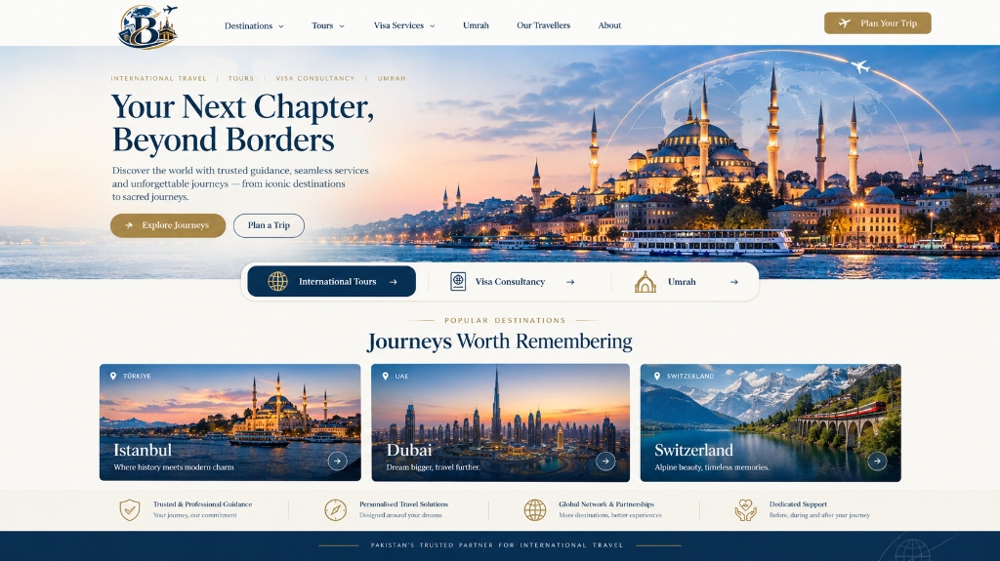
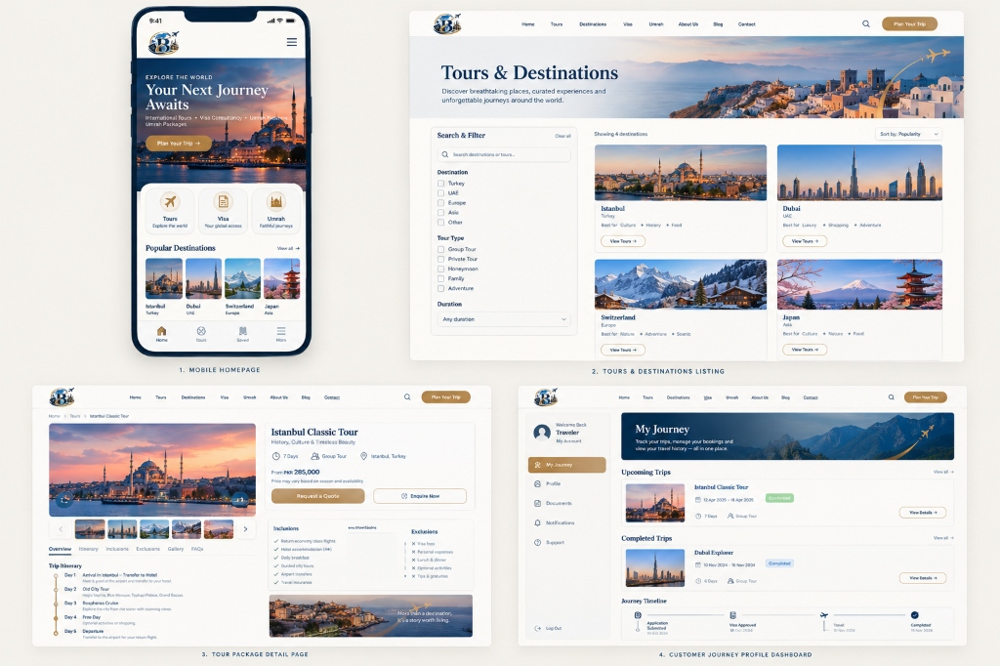

# Bilal Travels & Tours — Master Project Plan & Platform Blueprint

**Document Version:** 1.0.0  
**Status:** Discovery Complete — Ready for Phase 1  
**Project Owner:** Bilal Travels & Tours  
**Engineering Agent:** Antigravity Autonomous Engineering Agent  
**Last Updated:** October 2026  

---

## 1. Visual Brand Assets & UI/UX Design References

Below are the official visual identity assets and interface mockups provided for the project:

### 1.1 Official Brand Identity Logo

- **Monogram & Symbolism:** Deep Navy Blue 'B' monogram with golden orbital trajectory rings and global meridian lines.
- **Graphic Elements:** Aeroplane silhouette in flight, international passport ("PASSPORT") with globe emblem, visa travel documentation ("VISA"), and sacred architecture of Makkah Al-Mukarramah (Kaaba Sharif, Clock Tower, Minarets).
- **Core Pillars Represented:** International Tourism, Visa Consultancy, and Pilgrimage / Umrah Journeys.

---

### 1.2 Desktop Experience Wireframe & Aesthetic Direction

- **Brand Tagline:** *"Pakistan's Trusted Partner for International Travel"*
- **Primary Hero Banner:** *"Your Next Chapter, Beyond Borders"*
- **Sub-headline:** *"Discover the world with trusted guidance, seamless services and unforgettable journeys — from iconic destinations to sacred journeys."*
- **Primary CTAs:** `Explore Journeys` (Gold Solid), `Plan a Trip` (Outlined)
- **Core Pillars Pill Switcher:**
  1. `International Tours →`
  2. `Visa Consultancy →`
  3. `Umrah →`
- **Featured Destinations:** Istanbul (Türkiye), Dubai (UAE), Switzerland (Europe)
- **Key Value Indicators:**
  - Trusted & Professional Guidance
  - Personalised Travel Solutions
  - Global Network & Partnerships
  - Dedicated Support

---

### 1.3 Multi-Device Experience & Screen Inventory

1. **Mobile Homepage:**
   - Brand header with streamlined navigation drawer.
   - Quick access category icon grid (`Tours`, `Visa`, `Umrah`).
   - Popular Destinations horizontal carousel cards.
   - Sticky mobile bottom navigation bar (`Home`, `Tours`, `Saved`, `More`).
2. **Tours & Destinations Listing Screen:**
   - Multi-facet search and filter sidebar (Destination checkboxes, Tour Type checkboxes, Duration filters).
   - Dynamic sorting (`Sort by: Popularity`, Price, Duration).
   - Rich destination cards displaying tags (e.g. *Best for: Luxury, Shopping, Adventure*).
3. **Tour Package Detail Screen (e.g. Istanbul Classic Tour):**
   - High-impact photo gallery.
   - Package metadata: Duration (7 Days), Tour Type (Group Tour), Location (Istanbul, Turkey).
   - Pricing display: `From: PKR 285,000`.
   - Dual action CTAs: `Request a Quote` and `Enquire Now`.
   - Inclusions / Exclusions breakdown.
   - Day-by-day interactive itinerary timeline.
4. **Customer Journey Profile Dashboard ("My Journey"):**
   - Dedicated authenticated portal view.
   - Left navigation: `My Journey`, `Profile`, `Documents`, `Notifications`, `Support`.
   - Status cards: `Upcoming Trips` (e.g., "Confirmed") and `Completed Trips`.
   - Visual milestone stepper: `Application Submitted` → `Visa Approved` → `Travel` → `Completed`.

---

## 2. Project Vision & Governance

### 2.1 Role & Execution Model
- **Architect & Engineering Partner:** Autonomous execution within approved gates.
- **Strict Approval Policy:** No major phase, architecture change, or deployment is executed without explicit user permission.
- **Language Policy:** Communication in clear Roman Urdu; documentation, code, schema, and commits in professional English.

### 2.2 Core Deliverables
1. **Public Marketing Website:** Editorial, responsive, ultra-fast travel portal.
2. **Tour Packages & Destination Guides:** Filterable, categorized, itinerary-driven packages with PKR pricing.
3. **Visa Consultancy Hub:** Country-specific visa requirements, process timelines, and document checklists.
4. **Umrah Packages Section:** Respectful, comprehensive pilgrimage packages and spiritual travel guidance.
5. **Quote & Lead Generation Engine:** Validated, spam-protected enquiry forms sending instant alerts.
6. **Admin Operations Platform:** Protected role-based portal for staff to manage leads, packages, destinations, and applications.
7. **Consent-Controlled Traveller Stories:** Multi-step verification workflow ensuring no photo or customer story is published without explicit, revocable consent.
8. **Customer Travel Dashboard:** Secure portal for customers to track their booking status, visa milestones, and download vouchers.

---

## 3. Brand Design System Tokens

| Token | Hex Value | Usage |
| :--- | :--- | :--- |
| **Royal Navy** | `#102D4F` | Primary brand color, headers, navigation bars, solid trust backgrounds |
| **Globe Blue** | `#176B9B` | Secondary accent, interactive states, links, globe highlights |
| **Champagne Gold** | `#B58B45` | Premium accent, primary CTA buttons, badges, orbital rings |
| **Warm Ivory** | `#FAF8F3` | Page background, cards, soft editorial contrast |
| **Pure White** | `#FFFFFF` | Card backgrounds, modals, input fields |
| **Charcoal** | `#202B38` | Primary body text, high contrast headings |
| **Muted Slate** | `#5F6B78` | Subtitles, secondary text, metadata labels |
| **Subtle Border** | `#E3DED3` | Dividers, card borders, input borders |

### Typography
- **Headings & Display:** Editorial serif font (`DM Serif Display` or `Playfair Display`) for a luxurious, trustworthy feel.
- **Interface & Body:** Clean sans-serif font (`Inter` or `Manrope`) for exceptional legibility across all device sizes.

---

## 4. Phase-by-Phase Roadmap

### Phase 0: Repository Discovery & Environment Audit
- **Status:** **COMPLETED**
- **Results:**
  - Workspace `d:\Faiz\WebProjects\Bilal Travels & Tours` inspected.
  - Environment inspected (Git 2.50.1 ready, PostgreSQL 16 ready).
  - Assets copied to project repository (`docs/assets/`).
  - Master blueprint and project plan created.

---

### Phase 1: Requirements Gathering, Scope & User Journeys
- **Objective:** Finalize sitemap, data models for packages/visas/leads, form fields, and user journey state machines.
- **Key Tasks:**
  - Define exact data structure for Tour Packages (pricing, inclusions, exclusions, daily itinerary).
  - Define Visa Consultancy country specifications and document requirements.
  - Map lead lifecycle (`New Lead` → `Contacted` → `Quotation Sent` → `Payment/Processing` → `Completed`).
  - Document user journeys for visitors, travellers, and agency administrators.
- **Acceptance Criteria:** Approved `REQUIREMENTS.md` and complete specification sign-off.

---

### Phase 2: Brand Design System, UI Components & Wireframes
- **Objective:** Translate provided UI mocks into CSS design tokens, responsive layout rules, and component specifications.
- **Key Tasks:**
  - Setup Tailwind color palette, typography scales, shadows, and border radii.
  - Build component inventory: Navigation Bar, Hero Section, Feature Cards, Destination Cards, Itinerary Accordions, Badges, Form Inputs, Buttons.
  - Detail mobile drawer and sticky bottom navigation.
- **Acceptance Criteria:** Reusable component design system ready for integration.

---

### Phase 3: Technical Architecture, Database Design & Security Plan
- **Objective:** Design the relational database schema, authentication boundaries, and API architecture.
- **Key Tasks:**
  - PostgreSQL schema design (`destinations`, `packages`, `itineraries`, `enquiries`, `applications`, `customers`, `staff_roles`, `consent_records`, `stories`).
  - Row-Level Security (RLS) policies and least-privilege role definitions.
  - Private vs. public object storage architecture for traveller documents and photographs.
- **Acceptance Criteria:** `DATABASE_SCHEMA.md` and `ARCHITECTURE.md` documented and approved.

---

### Phase 4: Project Foundation, Tooling & Layout Shells
- **Objective:** Initialize the Next.js / React TypeScript codebase, configure environments, setup styling, and build global shells.
- **Key Tasks:**
  - Configure runtime, TypeScript, ESLint, Tailwind CSS.
  - Create global layouts (`Header`, `Footer`, `MobileNav`, `BaseContainer`).
  - Integrate official logo asset and fonts.
- **Acceptance Criteria:** Clean build, 0 lint errors, responsive blank layout running locally.

---

### Phase 5: Public Website & Dynamic Content Pages
- **Objective:** Build all public marketing pages matching the provided UI/UX mockups.
- **Key Tasks:**
  - Home Page (Hero, Core Offerings, Popular Destinations, Value Proposition grid).
  - Tours & Packages Listing (multi-facet filtering by destination, type, duration, price).
  - Package Detail Page (Istanbul Classic Tour and dynamic package templates with itinerary).
  - Visa Services & Umrah dedicated pages.
  - About Us, FAQs, Contact Us, and Legal Policy pages.
- **Acceptance Criteria:** Pixel-perfect match with provided mockups; responsive across desktop, tablet, and mobile.

---

### Phase 6: Enquiries, Lead Management & Operational Database
- **Objective:** Implement interactive quote requests, contact forms, and secure database storage.
- **Key Tasks:**
  - Server-side validation with Zod / schema validators.
  - Spam protection, rate limiting, and sanitization.
  - PostgreSQL database connection and enquiry persistence.
  - Notification hooks (Email / Admin alerts).
- **Acceptance Criteria:** Form submissions create real, secure records with feedback and zero customer data leaks.

---

### Phase 7: Admin Dashboard & Staff Role-Based Access Control (RBAC)
- **Objective:** Build protected back-office management platform for travel agents.
- **Key Tasks:**
  - Secure authentication for staff.
  - Modules: Leads & Enquiries, Tour Packages CMS, Visa Applications Tracker, System Audit Logs.
  - Role separation: Super Admin, Operations Manager, Content Editor.
- **Acceptance Criteria:** Non-staff cannot access admin routes; operations staff cannot escalate privileges.

---

### Phase 8: Journey Management, Media Consent & Public Story Publishing
- **Objective:** Implement the consent-controlled traveller story publishing engine.
- **Key Tasks:**
  - Private journey creation and photograph uploads.
  - Explicit consent recording (date, scope, channel approval).
  - Admin approval gate before any story or photograph can be viewed publicly.
  - Instant revocation mechanism that purges public caches upon consent withdrawal.
- **Acceptance Criteria:** Stories cannot be queried by public APIs unless verified consent exists and status is "Published".

---

### Phase 9: Customer Travel Portal ("My Journey")
- **Objective:** Build the authenticated self-service portal shown in the UI mockup.
- **Key Tasks:**
  - Customer login and profile management.
  - Real-time journey milestone stepper (`Application Submitted` → `Visa Approved` → `Travel` → `Completed`).
  - Secure document download center (e-visas, vouchers, flight tickets).
- **Acceptance Criteria:** Customers can only view their own bookings; zero cross-account data exposure.

---

### Phase 10: Approved External Integrations
- **Objective:** Connect confirmed third-party APIs (Transactional Email, WhatsApp API, Maps).
- **Key Tasks:**
  - Notification pipeline integration.
  - Interactive maps for destination landmarks.
- **Acceptance Criteria:** Resilient error handling and zero fake/mocked production responses.

---

### Phase 11: Security, Accessibility, SEO & Performance QA
- **Objective:** Comprehensive testing and optimization.
- **Targets:**
  - WCAG 2.2 AA accessibility compliance.
  - Core Web Vitals: LCP <= 2.5s, INP <= 200ms, CLS <= 0.1.
  - Automated tests for authentication, authorisation, form validation, and RLS policies.
- **Acceptance Criteria:** Passing audit reports and security verification.

---

### Phase 12: Production Deployment, Handover & Documentation
- **Objective:** Deploy to production environment with full operational guides.
- **Key Tasks:**
  - Production database provisioning and migrations.
  - Domain & SSL setup.
  - Staff training guide and backup/recovery documentation.
- **Acceptance Criteria:** Live running platform approved by project owner.

---

## 5. Security & Data Governance Checklist

- [x] **No Hardcoded Secrets:** All credentials stored in environment variables.
- [x] **No Sensitive Data in Public APIs:** Passports, CNICs, private phone numbers, and internal agent notes are strictly isolated.
- [x] **Signed Media URLs:** Customer identification documents are never served from public storage buckets.
- [x] **Explicit Consent Enforcement:** Travel photos require affirmative digital consent before public display.
- [x] **Audit Trails:** All administrative modifications and consent withdrawals are logged with timestamps and user IDs.
