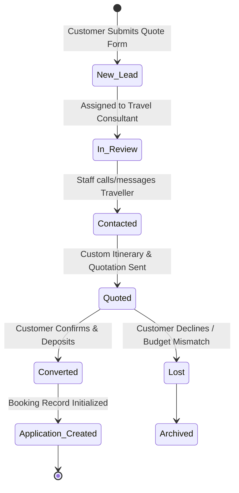
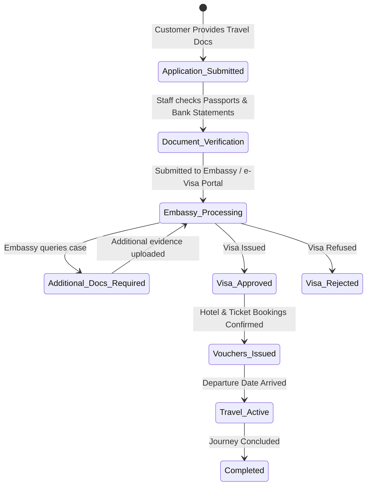
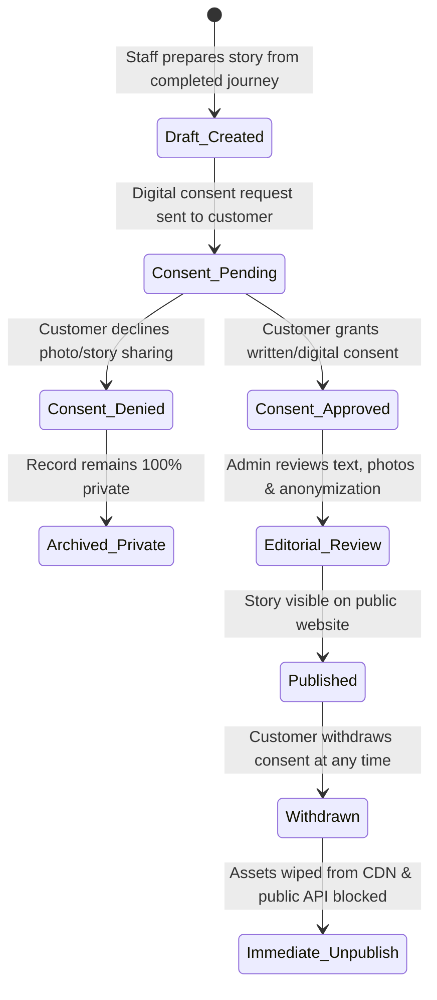

# Bilal Travels & Tours — System Requirements & Specifications (SRS)

**Document Version:** 1.0.0  
**Phase:** Phase 1 — Requirements, Scope & User Journeys  
**Project Owner:** Bilal Travels & Tours  
**Engineering Agent:** Antigravity Autonomous Engineering Agent  
**Status:** Approved for Implementation  

---

## 1. Executive Summary & Product Scope

Bilal Travels & Tours is a premier travel agency in Pakistan specializing in three core verticals:
1. **International Tours & Holiday Packages** (e.g., Türkiye, UAE, Europe/Switzerland, Southeast Asia)
2. **Visa Consultancy & Global Immigration Assistance** (e-Visas, sticker visas, document attestation, appointment assistance)
3. **Umrah & Pilgrimage Journeys** (VIP, Executive, Economy Umrah packages, private ground handling, Ziyarat tours)

The platform consists of three integrated sub-systems:
- **Public Customer Portal / Website:** High-end travel showcase, dynamic package search, transparent pricing, visa guides, and quote request engine.
- **Customer Journey Dashboard ("My Journey"):** Authenticated personal travel portal enabling travellers to track real-time application milestones, view itineraries, and download verified travel documents.
- **Agency Admin Management Platform:** Protected, role-based back-office platform for staff to manage inquiries, process visa applications, update tour packages, and curate consent-verified traveller stories.

---

## 2. Feature Inventory by Sub-System

### 2.1 Public Experience Modules

| Module ID | Module Name | Description & Capabilities |
| :--- | :--- | :--- |
| **PUB-01** | **Hero & Brand Portal** | Editorial hero section with tagline *"Your Next Chapter, Beyond Borders"*, dual CTAs (`Explore Journeys`, `Plan a Trip`), quick pillar switcher (`International Tours`, `Visa Consultancy`, `Umrah`), trust indicators, and agency credentials. |
| **PUB-02** | **Popular Destinations** | Visual destination cards (e.g., Istanbul, Dubai, Switzerland) with curated tags, high-resolution imagery, and direct links to packages. |
| **PUB-03** | **Tour Packages Catalog** | Dynamic listing with multi-facet filters: Destination checkboxes, Tour Type (Group Tour, Private Tour, Honeymoon, Family, Adventure), Duration slider, and Sorting (Popularity, Price, Duration). |
| **PUB-04** | **Tour Package Detail Page** | Full tour profile featuring: dynamic photo gallery, key facts (Duration, Tour Type, Group Size, City/Country), transparent base pricing (in PKR), Inclusions & Exclusions checklist, interactive day-by-day itinerary timeline with expandable activities, and dual CTAs (`Request a Quote` and `Enquire Now`). |
| **PUB-05** | **Visa Consultancy Hub** | Country-specific visa requirements, document checklists (financial docs, photos, passports, sponsorship letters), standard processing times, government fee guidance, and visa assessment enquiry form. |
| **PUB-06** | **Umrah Packages Section** | Specialized spiritual travel section: Makkah and Madinah hotel proximity (distance to Haram/Masjid an-Nabawi), package tiers (Economy, 4-Star, 5-Star VIP), airline options, Ziyarat itineraries, and Umrah visa guidance. |
| **PUB-07** | **Interactive Enquiry & Quote Engine** | Modal and embedded lead capture forms with instant server-side validation, anti-spam honeypot, trip customization fields (travel dates, number of adults/children, budget range), and immediate confirmation feedback. |
| **PUB-08** | **Consent-Verified Traveller Stories** | Editorial travel narratives and genuine customer experiences published strictly after documented, revocable digital consent verification. |
| **PUB-09** | **About Us & Trust Page** | Corporate background, accreditation, physical office details (when provided), customer support guarantees, and partnership disclosures. |
| **PUB-10** | **Legal & Compliance Pages** | Privacy Policy (GDPR/local data protection aligned), Terms & Conditions, and transparent Cancellation & Refund Policies. |

---

### 2.2 Customer Journey Portal ("My Journey")

| Module ID | Module Name | Capabilities & Access Control |
| :--- | :--- | :--- |
| **USR-01** | **Secure Authentication** | Magic link or secure password login with OTP confirmation. Strict account isolation. |
| **USR-02** | **My Journey Overview** | Unified traveller dashboard showing active upcoming journeys and past travel history. |
| **USR-03** | **Live Journey Milestone Stepper** | Visual progress tracker displaying sequential stages: `Application Submitted` → `Under Review` → `Visa Approved` → `Tickets & Vouchers Issued` → `Departed` → `Completed`. |
| **USR-04** | **Document Vault** | Secure, temporary signed URL downloads for confirmed booking vouchers, hotel confirmations, e-visas, and air tickets. No unauthenticated direct asset access. |
| **USR-05** | **Profile & Privacy Center** | Contact info management, marketing preferences, and digital consent management (grant or withdraw permission for traveller story publishing). |

---

### 2.3 Admin Management Platform (Back-Office)

| Module ID | Module Name | Capabilities & Role Restrictions |
| :--- | :--- | :--- |
| **ADM-01** | **Operations Overview** | Real-time KPI cards: Total active leads, conversion rate, pending visa applications, upcoming departures, and package popularity metrics. |
| **ADM-02** | **Leads & Inquiries Manager** | Comprehensive Kanban/Table view of all customer quote requests. Status management (`New`, `Contacted`, `Quoted`, `Converted`, `Lost`). Staff assignment and internal notes. |
| **ADM-03** | **Tour Packages CMS** | Full CRUD for tour packages, destination metadata, itinerary day builder, inclusion/exclusion lists, pricing rules, and media gallery uploads. |
| **ADM-04** | **Visa Applications Pipeline** | Tracking applicant documents, submission dates, embassy appointment dates, and visa outcome tracking with automated customer notification triggers. |
| **ADM-05** | **Traveller Stories & Consent Gate** | Secure workflow for staff to draft traveller stories from completed journeys, link documented customer consent records, preview public view, and trigger publishing only with formal admin sign-off. |
| **ADM-06** | **Staff & Role Management (RBAC)** | Role definitions: `Super Admin` (full platform control), `Operations Manager` (leads, bookings, packages), `Content Editor` (destinations, stories, blogs), and `Auditor` (read-only audit logs). |
| **ADM-07** | **Immutable Audit Logs** | Automatic server-side event logging for security-sensitive actions: role modifications, customer data access, document downloads, and consent changes. |

---

## 3. Core User Flows & State Machines

### 3.1 Lead Lifecycle State Machine

---

### 3.2 Visa Application Milestone Stepper

---

### 3.3 Consent-Controlled Traveller Story Workflow

---

## 4. Detailed Data Models & Specifications

### 4.1 Tour Package Entity Schema
- `id` (UUID, Primary Key)
- `title` (String, e.g. "Istanbul Classic Tour")
- `slug` (String, Unique, URL-friendly)
- `destination_id` (UUID, Foreign Key to Destinations)
- `subtitle` (String, e.g. "History, Culture & Timeless Beauty")
- `duration_days` (Integer, e.g. 7)
- `duration_nights` (Integer, e.g. 6)
- `tour_type` (Enum: `GROUP`, `PRIVATE`, `HONEYMOON`, `FAMILY`, `ADVENTURE`)
- `base_price_pkr` (Decimal / Integer, e.g. 285000)
- `price_display_type` (Enum: `FIXED`, `STARTING_FROM`, `ON_REQUEST`)
- `featured_image_url` (String)
- `gallery_image_urls` (Array of Strings)
- `inclusions` (Array of Strings, e.g. Return flights, 4-star hotel, Daily breakfast, Guided city tours, Airport transfers)
- `exclusions` (Array of Strings, e.g. Visa fees, Personal expenses, Lunch & dinner, Tips)
- `itinerary` (JSONB Array: `[{ day: 1, title: "Arrival in Istanbul", description: "Meet & greet at airport, transfer to hotel.", meals: "None", overnight: "Istanbul" }, ...]`)
- `is_featured` (Boolean, default: false)
- `status` (Enum: `DRAFT`, `PUBLISHED`, `ARCHIVED`)
- `created_at` / `updated_at` (Timestamps)

### 4.2 Lead & Enquiry Entity Schema
- `id` (UUID, Primary Key)
- `reference_no` (String, e.g. "BT-2026-1042")
- `customer_name` (String, required)
- `customer_email` (String, required)
- `customer_phone` (String, required, international format)
- `service_type` (Enum: `TOUR_PACKAGE`, `VISA_CONSULTANCY`, `UMRAH`, `CUSTOM_TRIP`)
- `target_destination` (String, optional)
- `package_id` (UUID, optional Foreign Key)
- `departure_date` (Date, optional)
- `adults_count` (Integer, default: 1)
- `children_count` (Integer, default: 0)
- `estimated_budget_pkr` (String / Integer, optional)
- `message` (Text, optional)
- `status` (Enum: `NEW`, `CONTACTED`, `QUOTED`, `CONVERTED`, `LOST`, `SPAM`)
- `assigned_staff_id` (UUID, optional Foreign Key)
- `internal_notes` (Text, strictly private)
- `created_at` / `updated_at` (Timestamps)

### 4.3 Visa Application Entity Schema
- `id` (UUID, Primary Key)
- `application_no` (String, e.g. "VSA-TUR-8921")
- `customer_id` (UUID, Foreign Key)
- `country_code` (String, e.g. "TR", "AE", "SA", "GB", "CH")
- `visa_category` (Enum: `TOURIST_EVISA`, `TOURIST_STICKER`, `BUSINESS`, `UMRAH_PILGRIMAGE`)
- `status` (Enum: `SUBMITTED`, `DOCS_VERIFIED`, `EMBASSY_PROCESSING`, `APPROVED`, `REFUSED`, `COMPLETED`)
- `submission_date` (Date)
- `expected_decision_date` (Date)
- `decision_date` (Date, nullable)
- `document_vault_ids` (Array of UUIDs referencing encrypted files)
- `created_at` / `updated_at` (Timestamps)

### 4.4 Traveller Story & Consent Entity Schema
- `id` (UUID, Primary Key)
- `title` (String, e.g. "Exploring Cappadocia & The Bosphorus")
- `slug` (String, Unique)
- `traveller_display_name` (String, e.g. "Faiz & Family" — anonymized per customer preference)
- `destination_id` (UUID, Foreign Key)
- `package_id` (UUID, optional Foreign Key)
- `travel_date` (Month/Year)
- `story_body` (Markdown / HTML)
- `published_photo_urls` (Array of Strings)
- **Consent Governance Fields:**
  - `consent_record_id` (UUID, Foreign Key to Consent Ledger)
  - `consent_granted_by` (String / Customer UUID)
  - `consent_granted_timestamp` (Timestamp)
  - `consent_scope` (Enum: `WEB_ONLY`, `WEB_AND_SOCIAL`, `ANONYMOUS_ONLY`)
  - `consent_status` (Enum: `PENDING`, `VERIFIED`, `REVOKED`)
  - `is_approved_by_admin` (Boolean, default: false)
  - `approved_by_staff_id` (UUID, Foreign Key)
- `status` (Enum: `DRAFT`, `PUBLISHED`, `WITHDRAWN`)
- `created_at` / `updated_at` (Timestamps)

---

## 5. Non-Functional Requirements (NFR)

### 5.1 Performance & Core Web Vitals
- **Largest Contentful Paint (LCP):** $\le 2.5\text{ seconds}$ on mobile and desktop.
- **Interaction to Next Paint (INP):** $\le 200\text{ milliseconds}$.
- **Cumulative Layout Shift (CLS):** $\le 0.1$.
- **Image Delivery:** Automatic Next.js image optimization utilizing WebP/AVIF formats with strict width/height aspect ratios to eliminate layout shifts.

### 5.2 Accessibility Standards
- **Target:** **WCAG 2.2 Level AA** compliance across all public and portal views.
- **Contrast Ratios:** Minimum $4.5:1$ contrast for standard text; minimum $3:1$ for large text ($18\text{pt}+$ or bold $14\text{pt}+$) against `#102D4F` and `#FAF8F3`.
- **Keyboard Usability:** Full keyboard tab navigation, visible focus rings (`focus-visible:ring-2 ring-gold`), skip-to-content links, and ARIA attributes on accordions, modals, and mobile navigation drawers.

### 5.3 SEO & Structured Data
- **Semantic HTML5:** Strict heading hierarchy (`h1` per page, followed by logical `h2` and `h3` tags).
- **Metadata Management:** Dynamic OpenGraph (`og:image`, `og:title`, `og:description`), Twitter Card tags, and canonical URLs on every package and destination page.
- **JSON-LD Schema Markup:**
  - `TravelAgency` structured data on Homepage.
  - `TourPackage` / `Product` structured data on Package Detail pages with PKR currency declarations.
  - `FAQPage` structured data on FAQ and Visa guide pages.

### 5.4 Security & Data Privacy Isolation
- **No Plaintext Passwords:** Argon2 or bcrypt password hashing handled by Supabase Auth / PostgreSQL auth extensions.
- **Strict Role-Based Access Control:** Admin API routes verify JWT claims and database roles server-side on every request.
- **Signed Private URLs:** Passports, bank statements, and visa approval PDFs are stored in non-public buckets; links expire within $15\text{ minutes}$.
- **Public API Isolation:** Public endpoints (`/api/packages`, `/api/destinations`, `/api/stories`) use strict SQL projection (`SELECT id, title, slug, price...`), strictly excluding customer personal identifiers, internal notes, and private files.

---

## 6. Phased Verification & Acceptance Criteria for Phase 1

1. **Requirements Completeness:** All 3 core business verticals (Tours, Visa, Umrah) have documented field schemas and workflows.
2. **State Machines Defined:** Clear transitions documented for Leads, Visas, and Stories.
3. **Data Protection Guaranteed:** Strict boundary between public views and private documents explicitly defined.
4. **Approval Gate:** Project Owner signs off on this requirements blueprint before technical architecture (Phase 2 & 3) begins.
